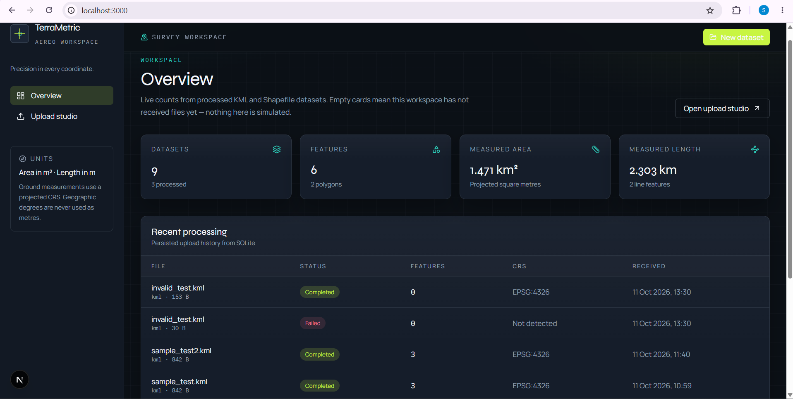
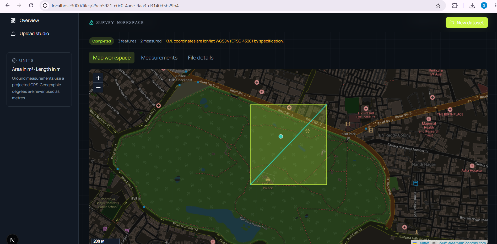
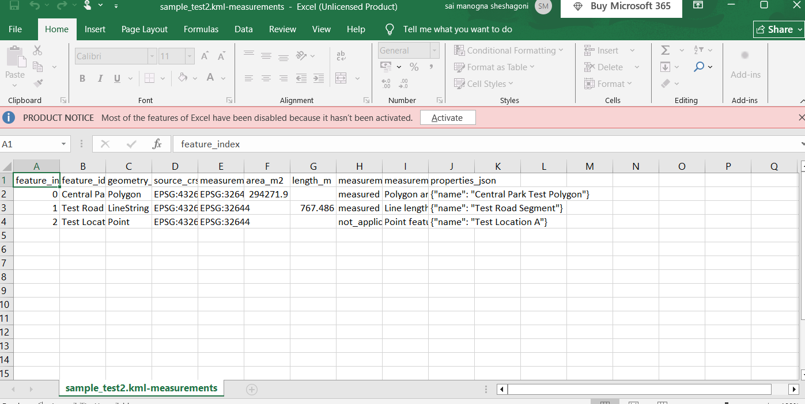

# TerraMetric

**Precision in every coordinate.**

TerraMetric is a geospatial workspace for surveying teams, GIS analysts, and infrastructure planners. Upload KML files or ZIP archives that contain shapefiles, inspect the extracted geometries on a dark cartographic map, and read defensible polygon area and line-length measurements stored in a local database.

This repository is a complete FastAPI + Next.js application: real file processing, projected measurements, persistent storage, a polished interface, and automated tests.

## Features

- Drag-and-drop upload for `.kml` and shapefile `.zip` archives
- Feature extraction: stable index, geometry type, GeoJSON, source CRS, attributes
- Polygon **area** and LineString **length** in metres after CRS transformation
- Interactive Leaflet map fitted to the actual dataset extent
- Measurement table with search, sort, filter, pagination, detail pane, and CSV export
- SQLite persistence of file metadata and per-feature results
- Safe ZIP extraction (path traversal and decompression limits)
- Dashboard metrics derived only from stored data — never fabricated

## Architecture

```
geospatial-file-measurement-api/
├── backend/                 FastAPI application
│   ├── app/
│   │   ├── main.py          App factory, CORS, lifespan
│   │   ├── routers/files.py Required + supporting endpoints
│   │   ├── services/        KML, shapefile, CRS, measurement, storage
│   │   ├── models.py        SQLAlchemy models
│   │   └── db.py            SQLite engine
│   └── tests/               pytest + genuine tiny datasets
├── frontend/                Next.js 15 App Router UI
└── README.md
```

The browser talks to `http://localhost:8000`. Uploaded bytes land in `backend/data/uploads/`. Feature rows and dataset metadata live in `backend/data/terrametric.db`.

## Prerequisites

- Python 3.11+ (developed against 3.14)
- Node.js 20+
- npm 10+

GDAL is not required. Shapefiles are read with `pyshp`; KML is parsed from XML. GeoPandas, Shapely, and PyProj perform CRS-aware measurement.

## Installation

From the repository root:

```powershell
python -m venv .venv
.\.venv\Scripts\Activate.ps1
pip install -r backend\requirements.txt

cd frontend
npm install
cd ..
```

Copy `.env.example` if you need to change ports, upload limits, or CORS origins.

```powershell
copy .env.example .env
```

Frontend API target (already created as `frontend/.env.local`):

```
NEXT_PUBLIC_API_URL=http://localhost:8000
```

## Run locally

Terminal 1 — API (from the repository root):

```powershell
.\.venv\Scripts\python -m uvicorn app.main:app --reload --port 8000 --app-dir backend
```

Terminal 2 — UI:

```powershell
cd frontend
npm run dev
```

Open [http://localhost:3000](http://localhost:3000). API docs: [http://localhost:8000/docs](http://localhost:8000/docs).

## Environment

| Variable | Default | Purpose |
| --- | --- | --- |
| `DATABASE_URL` | SQLite under `backend/data/` | Relational store |
| `UPLOAD_DIR` | `backend/data/uploads` | Controlled file storage |
| `MAX_UPLOAD_BYTES` | 26214400 (25 MB) | Upload cap |
| `CORS_ORIGINS` | `http://localhost:3000` | Browser origin allow-list |
| `NEXT_PUBLIC_API_URL` | `http://localhost:8000` | Frontend API base |

## API

Required assignment endpoints:

### `POST /api/files/`

`multipart/form-data` field `file`. Accepts `.kml` or `.zip`.

Example:

```powershell
curl -F "file=@survey.kml" http://localhost:8000/api/files/
```

Successful response (shape):

```json
{
  "id": "uuid",
  "original_filename": "survey.kml",
  "format": "kml",
  "status": "completed",
  "source_crs": "EPSG:4326",
  "measurement_crs_name": "EPSG:32633",
  "feature_count": 3,
  "measured_count": 2
}
```

### `GET /api/files/{id}/`

File metadata, processing status, feature counts, CRS notes, and WGS84 extent.

### `GET /api/files/{id}/measurements/`

Query parameters: `q`, `geometry_type`, `status`, `sort`, `order`, `page`, `page_size`.

```json
{
  "dataset_id": "uuid",
  "total": 3,
  "units": { "area": "square metres (m²)", "length": "metres (m)" },
  "items": [
    {
      "feature_id": "plot-a",
      "geometry_type": "Polygon",
      "area_m2": 1000000.0,
      "length_m": null,
      "measurement_status": "measured",
      "source_crs": "EPSG:4326"
    }
  ]
}
```

Supporting endpoints used by the UI: `GET /api/files/`, `GET /api/files/stats`, `GET /api/files/{id}/geojson`, `GET /api/files/{id}/measurements.csv`, `GET /api/health`.

Error bodies are `{ "detail": "...", "code": "..." }` with no filesystem paths or stack traces.

## Supported formats and CRS strategy

| Format | Source CRS |
| --- | --- |
| KML | EPSG:4326 by OGC specification |
| Shapefile ZIP | `.prj` WKT when present |

**Measurements are never computed in longitude/latitude degrees.**

1. Preserve the source CRS.
2. If the CRS is missing, store features and set `measurement_status` to `crs_missing`. No numeric area or length is returned.
3. If the source CRS is already projected in metres, measure in that CRS.
4. If the source CRS is geographic:
   - Compact extent (≤ 6° longitude and ≤ 8° latitude): UTM zone of the WGS84 centroid.
   - Broader extent: Lambert Azimuthal Equal Area centered on the centroid.

Units are metres and square metres. The UI also shows km / km² for large magnitudes. LAEA preserves area; length distortion grows away from the projection centre and is documented on the dataset.

## Measurement rules

| Geometry | Result |
| --- | --- |
| Polygon / MultiPolygon | `area_m2` |
| LineString / MultiLineString | `length_m` |
| Point / MultiPoint | catalogued, not measured |
| Empty, invalid, mixed collections | skipped or `unsupported` without failing the file |

Invalid geometries are repaired with `make_valid` when possible. Remaining failures are recorded per feature.

## Tests

```powershell
.\.venv\Scripts\pytest backend\tests
```

Coverage includes successful KML and shapefile ZIP uploads, malformed ZIP and invalid KML handling, metadata and measurement retrieval, polygon/line numerical checks against a 1000 m × 1000 m UTM square and a 5000 m transect, CRS selection, missing CRS, unsupported geometries, persistence of failures, and frontend contract fields.

Fixtures are generated in-process. Tests do not use the network.

Frontend:

```powershell
cd frontend
npm run lint
npm run build
```

## Screenshots

### Dashboard


### Upload Studio


### Map Workspace


### Dataset Details


### CSV Export
.

## Design decisions

- Dark charcoal / midnight navy workspace with lime and teal accents, Syne + Manrope + IBM Plex Mono, and a map-grid background so the product reads as a surveying instrument rather than a generic admin kit.
- Custom KML parser and `pyshp` keep Windows installs working without a GDAL toolchain, while GeoPandas still owns GeoDataFrame reprojection.
- Duplicate uploads with an identical SHA-256 return the existing completed dataset instead of writing a second copy.
- ZIP handling rejects `..` paths, absolute paths, oversized member counts, and oversized uncompressed payloads.

## Known limitations

- Very large multi-continent datasets use a single centered LAEA; lengths far from the centroid are approximate.
- A shapefile without `.prj` will not be measured, even if coordinates “look like” WGS84, to avoid silent degree-as-metre errors.
- 3D coordinates are flattened to 2D.
- Raster, FileGDB, and GeoPackage uploads are out of scope.

## Learning outcomes

Building TerraMetric is a walk through the difference between a geographic CRS and a projected metre CRS, defensive geospatial I/O, and a production-shaped upload-to-results workflow that a hiring reviewer can actually run.

## Future scope

- Geodesic area/length as a second, explicitly labelled method
- Authenticated multi-user workspaces
- Streaming processing for large archives
- Equal-area regional templates (Albers, UTM grids) selectable by the analyst

## Repository

**GitHub:** [TerraMetric — Geospatial Measurement Platform](https://github.com/SaiManogna-S/geospatial-file-measurement-api)

Clone the repository and follow the installation instructions above to run TerraMetric locally.